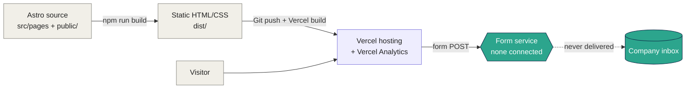

<div align="center">


<a href="#-how-it-works"></a>

<br/>

[](https://astro.build)
[](src/pages)
[](src/layouts/BaseLayout.astro)
[](https://vercel.com)
[](src/layouts/BaseLayout.astro)
<br/>
[](#-status)
[](LICENSE)

</div>

---

##  Project Overview

The public website of **Powerenv Technologies**, a Chennai start-up that pitches an end-to-end smart-metering platform to Indian electricity distribution companies (DISCOMs). The site argues that private LoRaWAN networks beat cellular (NB-IoT / 4G) for metering, presents the PowrMET meter, gateway and analytics platform, and funnels visitors to a "Request a Pilot Program" contact page. Built between August and September 2025.

### Key Features

-  **Six static pages** sharing one layout, header and footer, with a mobile slide-in menu.
-  **LoRaWAN vs cellular comparison table**: coverage, cost model, reliability, scalability, security.
-  **Scroll animations** with AOS (loaded from a CDN) and an IntersectionObserver fallback if the CDN is unreachable.
-  **Pilot-programme inquiry form**: name, designation, organisation, email, phone, message.
-  **Vercel Analytics** component in the base layout.

##  Pages and Sections

| Route | File | Content |
|---|---|---|
| `/` | `src/pages/index.astro` | Hero, "Trillion-Rupee Problem" (17%+ AT&C losses), three-card solution summary, Deploy / Collect / Deliver steps, closing call to action |
| `/our-solution` | `src/pages/our-solution.astro` | PowrMET smart meter, LoRaWAN gateway, data and analytics platform |
| `/the-technology` | `src/pages/the-technology.astro` | Why LoRaWAN: comparison table against cellular |
| `/our-impact` | `src/pages/our-impact.astro` | Environmental, social and governance (ESG) sections |
| `/about` | `src/pages/about.astro` | Mission and a four-person leadership / advisor grid |
| `/contact` | `src/pages/contact.astro` | Pilot-programme pitch, direct contact details, inquiry form |

Shared pieces: `BaseLayout.astro` (head, fonts, animation script, analytics), `Header.astro`, `Footer.astro`, `PageHeader.astro`. All copy is written directly in the `.astro` files; there is no CMS or content collection.

##  How It Works



The output is plain static files, so any static host works. The contact form carries the `data-netlify="true"` attribute, which only does something on Netlify; the site was deployed to Vercel, so submissions had nowhere to go (see [Status](#-status)).

##  Quick Start

Requires Node.js 18.20.8, 20.3 or newer (Astro 5).

```bash
git clone https://github.com/mukesh-dev-git/powerenv-technologies.git
cd powerenv-technologies
npm install
npm run dev        # http://localhost:4321
npm run build      # static site in ./dist
npm run preview    # serve the production build locally
```

No environment variables are needed.

##  Deployment

`astro.config.mjs` is intentionally empty (no `site` or `base`), so the build works at the root of a domain such as Vercel or a custom domain.

- **Vercel**: import the repo; Astro is detected automatically (build `npm run build`, output `dist`). Analytics works only on Vercel.
- **Any static host**: upload `dist/`.
- **GitHub Pages**: needs `site` and `base: '/powerenv-technologies'` set again in `astro.config.mjs`, plus a workflow; the original one was deleted in August 2025.
- **Form**: replace the `data-netlify` form in `src/pages/contact.astro` with a real endpoint (Formspree, Web3Forms, Netlify Forms if you host on Netlify, or your own function) before relying on it.

##  Project Structure

```
powerenv-technologies/
├── astro.config.mjs            # empty config (root-path hosting)
├── package.json                # astro, @vercel/analytics (+ unused gsap, locomotive-scroll)
├── public/
│   ├── favicon.svg
│   ├── images/                 # logo, product renders, team photos (PNG/JPG, several MB each)
│   └── styles/                 # global.css, animations.css (linked);
│                               # power-loader.css, smart-grid-loader.css (not linked)
└── src/
    ├── layouts/BaseLayout.astro
    ├── components/             # Header, Footer, PageHeader
    └── pages/                  # index, our-solution, the-technology, our-impact, about, contact
```

##  Status

Archived. The site was live on Vercel until the deployment was removed; the last commit is from 14 September 2025.

| Area | State |
|---|---|
| Pages and copy | Complete: all six pages have finished text, no lorem ipsum or TODOs |
| Build | `npm run build` succeeds (6 pages, Astro 5.13.4) |
| Contact form | Does not work: `data-netlify` form but hosted on Vercel, no endpoint, no confirmation page |
| Loader animation | CSS files remain in `public/styles/` but are not linked; locomotive-scroll and GSAP were added then removed from the code, and still sit in `package.json` |
| Images | Three section photos are hot-linked from Pexels; PNG assets are large (up to ~6 MB) and not optimised |
| Image paths | About, Solution and Impact pages use relative `./images/...` paths (one has a trailing space in the file name) |
| SEO | One generic meta description in the layout; no canonical URL, sitemap or Open Graph tags |
| Tests, CI | None |

### External services

| Service | Used for | State |
|---|---|---|
| Vercel (`powerenv-technologies.vercel.app`) | Hosting, Git-triggered deploys | Gone: domain resolves but returns `DEPLOYMENT_NOT_FOUND` (404) |
| Vercel Analytics | Page-view analytics (`@vercel/analytics`, no ID in code) | Gone with the deployment |
| GitHub Pages (`mukesh-dev-git.github.io/powerenv-technologies`) | First hosting attempt, workflow removed Aug 2025 | Gone: returns 404 |
| Netlify Forms | Contact form (`data-netlify` attribute only) | Never connected; site was not on Netlify |
| Google Fonts, cdnjs (AOS), Pexels | Fonts, animation library, three photos | Public CDNs, still reachable |

##  License

The source code is MIT. See [LICENSE](LICENSE). The Powerenv Technologies name, logo, product renders and written content, the team photographs and personal details on the About and Contact pages belong to the company and the people shown; do not reuse them without permission. The stock photos are from Pexels under its own licence.

<div align="center">


</div>
